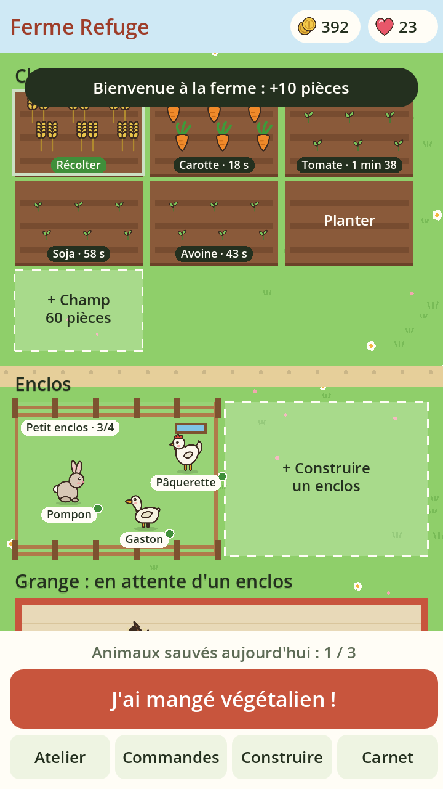

# Ferme Refuge

Un jeu de ferme sur téléphone où chaque repas végétalien sauve un animal.



On cultive, on transforme ses récoltes à l'atelier et on remplit les commandes des voisins pour gagner des pièces. Quand on a mangé un repas végétalien, on le déclare sur l'honneur : un animal sauvé arrive à la ferme. Les animaux ne produisent rien. Ce sont des résidents qu'on nourrit et qu'on câline, et quand ils sont heureux ils rapportent des cœurs.

## Les règles en bref

- **Champs** : planter coûte des graines, chaque récolte donne 2 unités, ou 4 sur un champ amélioré au niveau 2 (150 pièces).
- **Atelier** : 3 blés font un pain, 3 sojas un tofu, etc. Chaque recette propose une vraie idée de plat.
- **Commandes** : les voisins paient 50 % de plus que le marché.
- **Repas** : 3 sauvetages maximum par jour, sur l'honneur. Vaches, ânes et chevaux n'arrivent qu'après plusieurs jours d'affilée.
- **Enclos** : petit (poule, lapin, canard), moyen (cochon, mouton, chèvre, dinde), grand (vache, âne, cheval). Un animal sans place attend dans la grange.
- **Clôtures** : des couleurs à acheter avec les cœurs, puis à appliquer sur n'importe quel enclos en le touchant.
- **Bonheur** : il baisse doucement avec le temps. Caresser donne +10 (toutes les 3 h), nourrir +15, ou +30 avec la culture préférée.

Tous les réglages (prix, temps de pousse, espèces) sont dans `scripts/data.gd`.

## Organisation du code

| Fichier | Rôle |
| --- | --- |
| `scripts/data.gd` | Données de réglage : cultures, recettes, animaux, enclos |
| `scripts/game.gd` | État de la partie, règles et sauvegarde (chargé automatiquement sous le nom `Game`) |
| `scripts/farm_view.gd` | Dessin de la ferme et gestion des touchers |
| `scripts/main.gd` | Écran principal, boutons et fenêtres |
| `tests/test_regles.gd` | Vérification des règles sans interface |

Les dessins sont des fichiers SVG dans `art/` (animaux, cultures, objets), modifiables avec n'importe quel logiciel de dessin vectoriel comme Inkscape. Ils sont importés en double résolution pour rester nets sur téléphone.

## Lancer le jeu

1. Installer [Godot 4.3](https://godotengine.org/download) (version standard, pas .NET).
2. Ouvrir Godot, cliquer sur « Importer » et choisir le fichier `project.godot`.
3. Appuyer sur F5. Dans l'éditeur, la souris remplace le doigt.

Lancer les tests :

```
godot --headless --path . -s tests/test_regles.gd
```

## Fabriquer l'APK Android

1. Dans Godot : Éditeur > Gérer les modèles d'exportation > Télécharger.
2. Installer le JDK 17 et le SDK Android, puis renseigner leurs chemins dans Éditeur > Paramètres de l'éditeur > Export > Android.
3. Projet > Exporter > Ajouter… > Android, puis « Exporter le projet » pour obtenir le fichier `.apk`.

Le guide officiel détaille chaque étape : https://docs.godotengine.org/fr/4.x/tutorials/export/exporting_for_android.html

## Prochaines étapes possibles

- Prendre une photo du repas pour le carnet (souvenir, sans analyse).
- Animations des animaux (marche, câlin, repas).
- Dépenser les cœurs : décorations, potager, mare.
- Défis de la semaine et compteur d'impact.
- Construction automatique de l'APK sur GitHub.
